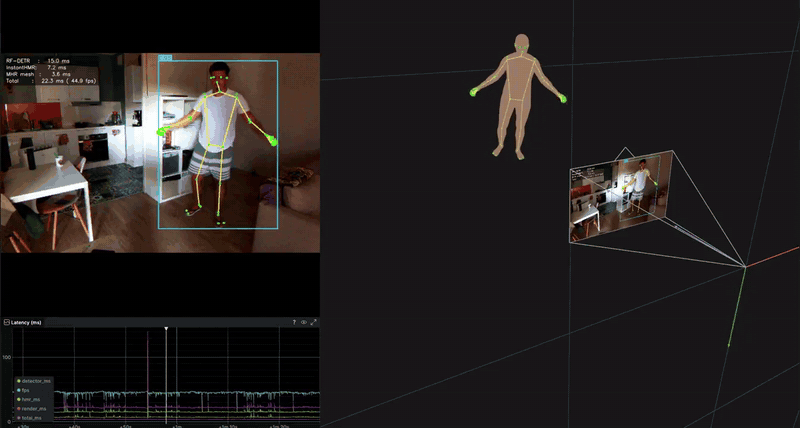
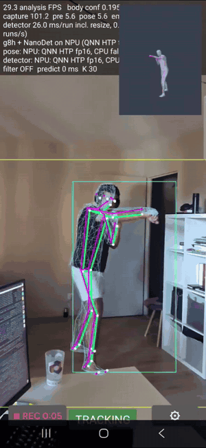

# InstantHMR: Real-Time Human Mesh Recovery on Your Phone

<p align="center">
  <a href="https://huggingface.co/momolesang/InstantHMR"></a>
  
</p>

InstantHMR recovers the 3D body of every person in an image: pose, body shape, 70 keypoints in 2D
and 3D, and a full body mesh in the [Momentum Human Rig](https://github.com/facebookresearch/MHR)
(MHR). It runs in about 5 ms per person on a phone NPU and in about 1 ms on a desktop GPU.

<p align="center">
  
  
</p>

## Models

Four sizes, trained on the released annotations of the
[SAM 3D Body dataset](https://huggingface.co/datasets/facebook/sam-3d-body-dataset).
Accuracy is PA-MPJPE (lower is better) under the protocol of the paper; latency is per person,
for the model alone on the GPU as measured in the paper (the desktop column with TensorRT directly,
up to a 6,890-vertex mesh).

| Model | Parameters | EMDB-1 (mm) | 3DPW (mm) | RTX 4070, TensorRT (ms) | Galaxy S23 NPU (ms) | Licence |
|---|---|---|---|---|---|---|
| `nano` | 20.0 M | 61.7 | 46.6 | 0.70 | 4.60 | CC BY-NC 4.0 |
| `tiny` | 20.3 M | 58.0 | 44.0 | 0.73 | 4.84 | CC BY-NC 4.0 |
| `small` | 24.4 M | 53.3 | 41.7 | 0.84 | 5.38 | CC BY-NC 4.0 |
| `medium` (default) | 32.2 M | 48.8 | 40.0 | 0.98 | 5.49 | CC BY-NC 4.0 |
| `medium-commercial` | 32.2 M | 72.2 | 50.7 | 0.98 | 5.49 | Apache-2.0 |

`medium-commercial` is the medium model trained only on images that allow commercial use
(Harmony4D and part of COCO). The weights download automatically from
[Hugging Face](https://huggingface.co/momolesang/InstantHMR) on first use.

## Install

Python 3.10 to 3.12, and on Linux or Windows an NVIDIA driver 525 or newer.

```bash
git clone https://github.com/Naturalpad-studio/InstantHMR.git
cd InstantHMR
python -m venv .venv && source .venv/bin/activate
pip install torch torchvision --index-url https://download.pytorch.org/whl/cu126
pip install -r requirements.txt
```

The first `pip` line installs PyTorch for CUDA 12, which the person detector uses and onnxruntime
shares, so a single set of CUDA libraries is installed. On a Mac, or without an NVIDIA GPU, skip
it.

## Demo

```bash
python demo.py --image photo.jpg
python demo.py --video clip.mp4 --smooth
python demo.py --camera 0
```

The [Rerun](https://rerun.io) viewer opens with the frame and its 2D skeletons, the 3D scene, and
the latency of each stage. People are found by the [RF-DETR](https://github.com/roboflow/rf-detr)
detector, then InstantHMR runs on all of them in one batch.

| Option | |
|---|---|
| `--model` | `nano`, `tiny`, `small`, `medium` (default), `medium-commercial`, or a path to an `.onnx` file |
| `--device` | `cuda` (default), `tensorrt`, `cpu` or `coreml` |
| `--smooth` | temporal smoothing for videos and cameras (1 Euro filter, no visible lag) |
| `--focal` | the camera's focal length in pixels, if you know it; it places people at the right depth |
| `--detector` | RF-DETR size: `nano`, `small`, `medium` (default), `base`, `large` |
| `--max-persons` | most people per frame (default 4) |
| `--no-mesh` | skeleton only |
| `--save-rrd` | also save the recording, to replay with `rerun file.rrd` |

The latencies in the table above are the model alone on the GPU, as measured in the paper. The
demo's timings are what a frame costs end to end in Python: on an RTX 4070 with TensorRT, the
InstantHMR stage takes about 5 ms per person, of which 1.8 ms cut and normalise the crop on the CPU,
1.3 ms run the network and 1.5 ms build the keypoints and the full 18,439-vertex mesh. The
detector is the slow stage (about 27 ms for RF-DETR medium); for a faster live demo, use
`--detector nano` or `--detector-stride 2`.

## Use it from Python

```python
import cv2
from instanthmr import PosePipeline

pipeline = PosePipeline("medium", device="cuda")
image = cv2.cvtColor(cv2.imread("photo.jpg"), cv2.COLOR_BGR2RGB)
for person in pipeline(image).persons:
    person.joints_2d        # (70, 2) keypoints, pixels
    person.joints_3d_cam    # (70, 3) keypoints, metres, camera frame (x right, y down, z forward)
    person.vertices_cam     # (18439, 3) mesh, metres, camera frame; faces: pipeline.hmr.faces
    person.mhr_params       # (204,) MHR pose and skeleton parameters
    person.shape_params     # (45,) MHR body shape
```

With your own person boxes, use `InstantHMR` directly:
`InstantHMR(resolve_model("medium")).predict(image, boxes)`. The 70 keypoints are listed in
`instanthmr.JOINT_NAMES`.

## TensorRT

TensorRT runs InstantHMR in fp16 on NVIDIA GPUs. Install it next to onnxruntime and pick the
device:

```bash
pip install tensorrt-cu12==10.15.*
python demo.py --camera 0 --device tensorrt
```

The first run builds an engine for your GPU, about two minutes, and caches it in
`models/trt_cache/`; later runs start in under a second. The engine covers batches of up to
`--max-persons` people. On an RTX 4070, the `medium` network takes 1.2 ms per person with
TensorRT against 3.5 ms with CUDA; the MHR body (keypoints and mesh) runs on CUDA in 1.2 ms
either way.

## Training and evaluation

- [`training/`](training/README.md): train the released models, or your own, from the SAM 3D Body
  annotations, and export them to ONNX.
- [`datasets_pipeline/`](datasets_pipeline/README.md): download the annotations and images and
  build the training data.
- [`benchmark/`](benchmark/README.md): reproduce the paper's EMDB-1 and 3DPW numbers.

## Licence

The code is under the [Apache-2.0](LICENSE) licence. The `nano`, `tiny`, `small` and `medium`
weights are under [CC BY-NC 4.0](https://creativecommons.org/licenses/by-nc/4.0/), for
non-commercial use only, because some of their training images (SA-1B, AI Challenger) are; `medium-commercial` and the MHR body graph are under Apache-2.0. The body model is Meta's
[MHR](https://github.com/facebookresearch/MHR) (Apache-2.0).

## Acknowledgements

InstantHMR is trained on the annotations Meta released with
[SAM 3D Body](https://github.com/facebookresearch/sam-3d-body) and uses Meta's
[MHR](https://github.com/facebookresearch/MHR) body model. People are detected with
[RF-DETR](https://github.com/roboflow/rf-detr) and shown with [Rerun](https://rerun.io). Training
was granted access to the HPC resources of IDRIS under the allocation AD011017116 made by GENCI.

## Citation

<!-- ticket 20: add the arXiv identifier. -->
```bibtex
@article{adjel2026instanthmr,
  title  = {InstantHMR: Real-Time Human Mesh Recovery on Your Phone},
  author = {Adjel, Mohamed and Chalabi, Kahina and Bonnet, Vincent},
  year   = {2026}
}
```
